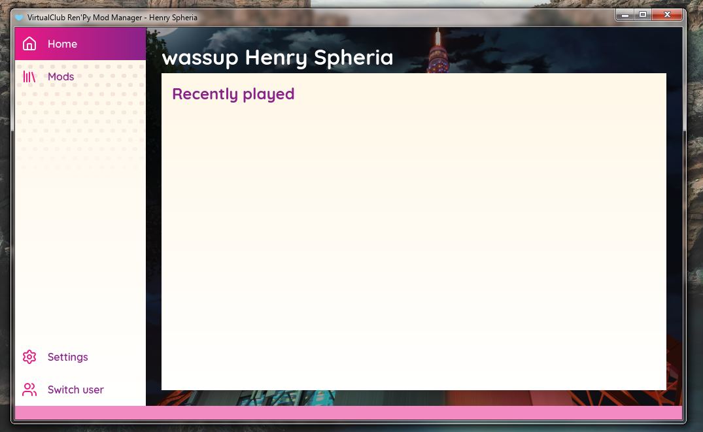
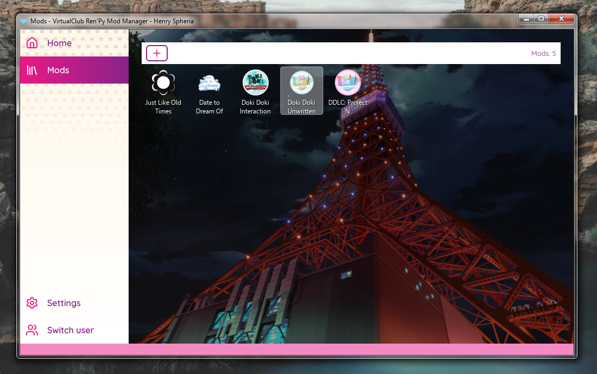
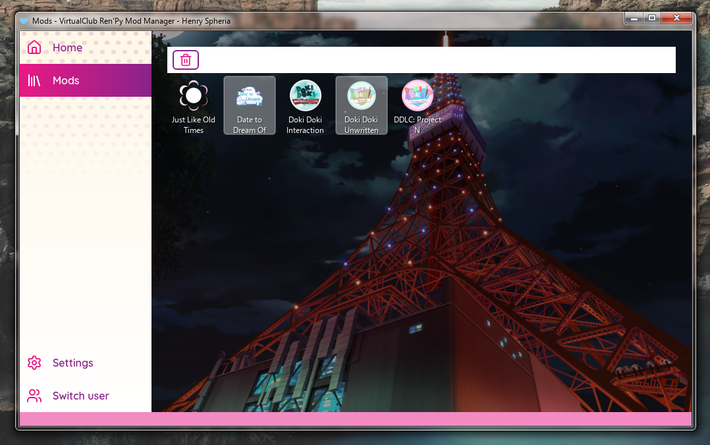
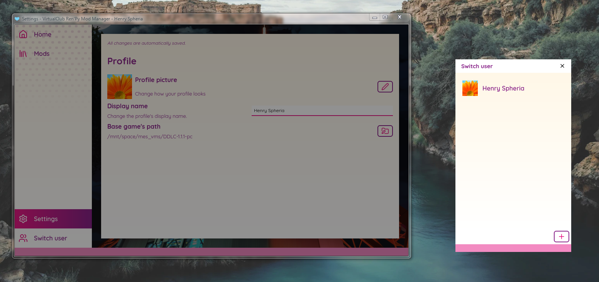
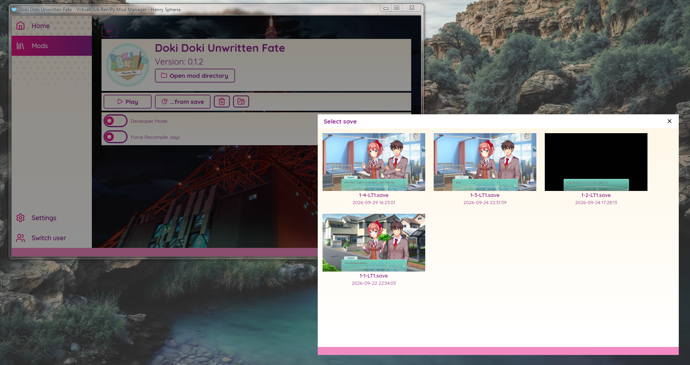

> This section is mainly for developers. Regular users should skip straight to [the Releases page](https://github.com/HenrySck075/VirtualClub/releases).
> This application is also in an early stage, so there's prone to bugs, although it's mostly on other parts of the app, the core feature of mod launching works fine, hopefully.


looks smth like this atm




Mods screen


ditto with multiple items selected by Shift+click


Settings screen and the Switch user dialog


Mod info screen and save selection dialog (by clicking "...from save" button)

## Notice
This is a completely independent project and is not affiliated with any parties referenced throughout the program's interface.

## How Does This Work
long answer, magic

short answer, the "virtual filesystem" technology allows the launcher to construct a fake folder that replicates the traditional setup of a Ren'Py mod installation without actually consuming more disk spaces from making a copy of both the base game and the mod.<br>meaning you get the benefit of disk space efficiency AND isolated save content. 


## Dependencies
These lists the dependencies that do not automatically get installed by the project:
- Git (ofc)
- Qt6
- Python
- FUSE3 (or WinFsp on Windows, requires enabling the driver)
- LibArchive

### Cross-Compiling (Using MinGW)
The cross-compiling snippet you saw on the codebase assumes an Arch Linux setup (i use arch btw).<br>
Additionally, this requires Wine for `--install`ing the app

Configure the project:
```
x86_64-w64-mingw32-cmake -G Ninja -B build-win64 -DCMAKE_TOOLCHAIN_FILE="$PWD/cmake/mingw64.cmake" -DCMAKE_BUILD_TYPE=Debug -DWINFSP_DIR="/path/to/WinFsp"
```
Where `WINFSP_DIR` is a copy of `C:\Program Files (x86)\WinFsp` from a Windows installation
